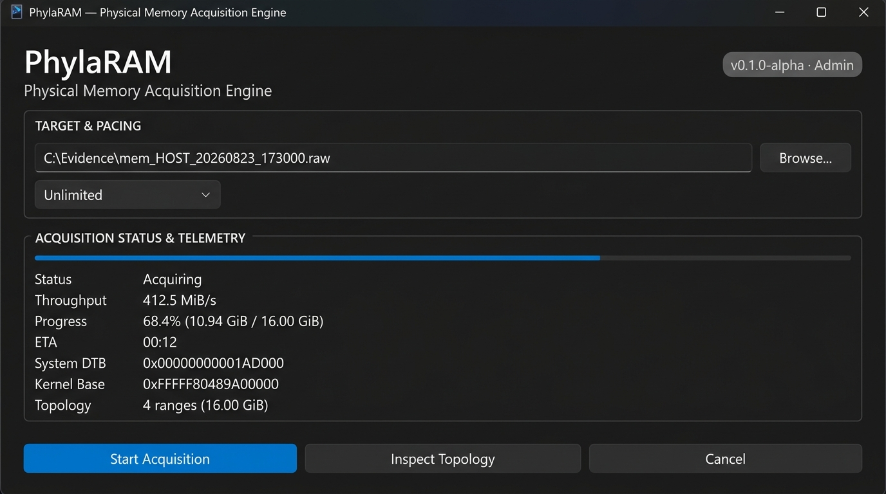
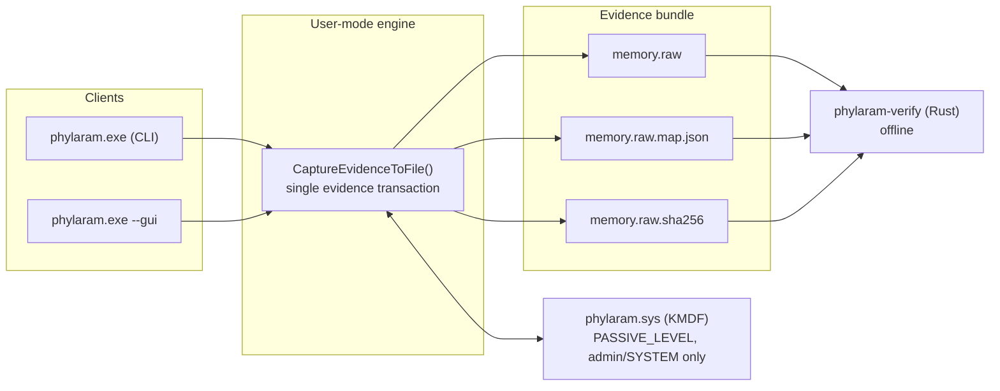

# PhylaRAM

[](https://github.com/joeyvictorino/phylaram/actions/workflows/ci.yml)
[](https://github.com/joeyvictorino/phylaram/releases)
[](LICENSE)

> [!WARNING]
> **Alpha software. Lab & controlled test environments only.**  
> PhylaRAM's kernel driver (`phylaram.sys`) is currently test-signed with a self-signed certificate for test VMs. Production Microsoft driver signing, Driver Verifier 100-cycle stress, and physical-hardware matrix gates are actively tracked in [`docs/STATUS.md`](docs/STATUS.md).  
> **Do not disable Secure Boot or HVCI/Memory Integrity on a real evidence host merely to load an alpha driver.**

PhylaRAM acquires live physical memory from Windows x64 hosts and records exactly what it could and could not read. A small KMDF driver serves bounded reads, a C++20 engine (CLI and Win32 GUI) writes the image, and an independent Rust tool re-checks the finished evidence bundle offline. The point is provenance: a page the hardware refused to return is isolated at 4 KiB granularity and recorded in a JSON map with its exact `NTSTATUS`, so an analyst can tell "unreadable" from "observed zeros". Every capture ends with a SHA-256 sidecar and is published atomically. Status: `0.1.0-alpha`; the build and the portable tests pass in CI, while the driver has not been validated on physical hardware, under Driver Verifier, or with production signing (see [Validation status](#validation-status)).


*GUI layout (dark mode). The values shown are sample values, not a benchmark; no performance measurements have been recorded yet ([`docs/BENCHMARKS.md`](docs/BENCHMARKS.md)).*

## Quickstart

### A. Check the verifier and tests on any machine (no Windows needed)

Needs Python 3, a C++20 compiler (`clang++`, or set `CXX`) and a Rust toolchain.

```bash
git clone https://github.com/joeyvictorino/phylaram
cd phylaram
python3 tests/run_all_tests.py      # 14 steps; about a minute once the Rust dependencies are built
```

This runs the policy check, the C++20 model tests, the Rust verifier's fmt/clippy/tests, a synthetic-bundle fixture run through the verifier, and the hostile-input rejection suite. It does not touch a driver and does not close any Windows or hardware gate.

### B. Acquire memory in a Windows lab VM (alpha, test-signed)

Use a dedicated test VM, never a real evidence host. The steps follow [`README-FIRST.txt`](README-FIRST.txt), which ships inside the release archive; the test-signed binaries are attached to the [pre-release](https://github.com/joeyvictorino/phylaram/releases).

```cmd
:: elevated prompt in the test VM
bcdedit /set testsigning on
:: reboot, then run install_test_cert.bat as Administrator

phylaram.exe C:\evidence\test_capture.raw
phylaram-verify.exe C:\evidence\test_capture.raw C:\evidence\test_capture.raw.map.json C:\evidence\test_capture.raw.sha256
```

Other invocations (see `phylaram.exe --help`):

```cmd
phylaram.exe --gui                                :: native GUI
phylaram.exe --dry-run [--json]                   :: topology and kernel hints, writes no evidence
phylaram.exe C:\evidence\mem.raw --rate-limit 100 :: throttle to 100 MiB/s
phylaram.exe C:\evidence\mem.e01 --case-number C-1 --examiner "A. Analyst"
```

Output format follows the extension or `--format raw|zdmp|dmp|e01`. RAW is the default and the only format `phylaram-verify` checks; `.zdmp`/`.dmp` (Complete Memory Crash Dump layout) and `.e01` are experimental: their tests check header layouts only and no third-party reader has been run against their output.

## What it does not do

- It is not production-signed. The driver is test-signed, not WHCP/HLK certified, and no Secure Boot or HVCI compatibility is claimed.
- It has not been validated on physical hardware, under Driver Verifier stress, or on real acquired images in Volatility 3 or MemProcFS. Those gates are open.
- It does not stream to stdout, skip hashing, skip the provenance map, or overwrite existing evidence.
- It does not acquire memory on Linux or macOS. Only the verifier and the portable tests run there.
- It does not analyze memory or interpret findings; the map records acquisition facts only.
- A passing `phylaram-verify` shows the bundle is internally consistent. It does not establish chain of custody or legal admissibility.
- It publishes no benchmark numbers or comparisons with other tools.

## Evidence bundle

Every successful capture produces exactly three files:

```text
memory.raw          # flat image: file offset == physical address; unpopulated gaps stay sparse
memory.raw.map.json # provenance map, schema phylaram-map-2 (see docs/MAP_SCHEMA.md)
memory.raw.sha256   # SHA-256 of the logical image
```

Evidence is written to `.partial` staging files and promoted to the final names only after all bytes are flushed, byte accounting balances and the sidecars are final. The CLI refuses to overwrite existing evidence or staging files.

| Exit code | Meaning |
| :---: | :--- |
| `0` | Complete: all bytes acquired, accounting balanced, topology stable, bundle finalized. |
| `2` | Incomplete: bundle finalized, but unreadable spans or a topology change were recorded. |
| `1` | Failed or cancelled: no final bundle published; staging files removed. |

The map records producer and schema version, terminal status, byte accounting (`logical_size`, `physical_bytes`, `acquired_bytes`, `unreadable_bytes`), the frozen physical-memory runs, each unreadable span with its `NTSTATUS`, and acquisition-time kernel hints (System-process CR3/DTB, kernel base, build number).

## Architecture



Design properties, each enforced in code:

- **Bounded kernel protocol.** The driver snapshots the physical-memory ranges (`MmGetPhysicalMemoryRangesEx2`) when a session starts. A read request carries only a run index, an offset within that run and a length (`PHYLA_READ_REQUEST` in `shared/phylaram.h`); user mode cannot supply a physical address. The device is restricted to SYSTEM and Administrators by SDDL.
- **Partial reads are kept.** Reads use `MmCopyMemory`; a failed 16 MiB transfer is retried at 4 KiB page granularity so readable bytes are preserved and only the failing pages are recorded as unreadable.
- **One transaction for CLI and GUI.** Neither presentation layer decides on its own that evidence is complete.
- **Independent verification.** `phylaram-verify` re-derives the checks from the three files without trusting the producer: logical size equals the highest physical range end equals the RAW file size; ranges are ordered, non-overlapping and sum to `physical_bytes`; unreadable spans lie inside physical runs, do not overlap and are zero-backed in the file; the terminal status matches the byte accounting; and the SHA-256 matches both the map and the sidecar.

| Path | Contents |
| :--- | :--- |
| `driver/` | C17 KMDF driver `phylaram.sys` |
| `cli/` | C++20 acquisition engine, evidence transaction, writers, native GUI |
| `shared/` | ABI shared by driver and engine (compile-time size assertions) |
| `tools/phylaram-verify/` | Rust offline verifier with property tests |
| `tools/*.py` | Offline converter and Volatility 3 / MemProcFS launch helpers, benchmark script |
| `tests/` | C++20 model tests, Python fixture, topology and hostile-input suites |
| `integrations/velociraptor/` | Example artifacts (not exercised by any test here) |
| `docs/` | Architecture, map schema, status, validation evidence, signing/HVCI guide |

## Build from source

Windows (driver, CLI, GUI), with Visual Studio 2022 (MSVC v143, C++20); the WDK comes from NuGet:

```cmd
nuget restore packages.config -PackagesDirectory packages
msbuild PhylaRAM.sln /p:Configuration=Release /p:Platform=x64 /v:minimal /m
```

The Rust verifier builds anywhere with a current stable toolchain: `cd tools/phylaram-verify && cargo build --release`.

## Tests

```bash
python3 tests/run_all_tests.py     # everything portable, as above
```

CI ([`ci.yml`](.github/workflows/ci.yml)) runs that battery on macOS, builds the driver, CLI and verifier on `windows-2022` with CI test signing, and uploads the test-signed artifacts. [`codeql.yml`](.github/workflows/codeql.yml) runs CodeQL for C/C++ weekly and on pushes. Passing CI is necessary but not sufficient: it does not substitute for hardware validation.

## Validation status

| Gate | Target | State |
| :--- | :--- | :--- |
| 1 | Windows x64 build and packaging in CI | Passing in CI; must stay green at the release commit |
| 2 | Static Driver Verifier and CodeQL | CodeQL runs; SDV open |
| 3 | Driver Verifier stress, 100 cycles | Open |
| 4 | Physical hardware and topology matrix (4 GB to 128 GB+, ReBAR, NUMA) | Open (simulated topology models only) |
| 5 | Production Microsoft driver signing, Secure Boot/VBS/HVCI | Open |
| 6 | Real acquired images in Volatility 3 and MemProcFS | Open (synthetic fixtures only) |

Details and evidence logs: [`docs/STATUS.md`](docs/STATUS.md), [`docs/VALIDATION_EVIDENCE.md`](docs/VALIDATION_EVIDENCE.md). Reproducible results from real lab environments are the most useful contribution: see [`docs/COMMUNITY_VALIDATION.md`](docs/COMMUNITY_VALIDATION.md) and the Validation Result issue template. A failed run is useful evidence.

## Contributing, security, license

- [`CONTRIBUTING.md`](CONTRIBUTING.md) and [`ENGINEERING_STANDARD.md`](ENGINEERING_STANDARD.md)
- [`SECURITY.md`](SECURITY.md): report vulnerabilities privately
- MIT licensed, see [`LICENSE`](LICENSE); third-party notices in [`THIRD_PARTY_NOTICES.md`](THIRD_PARTY_NOTICES.md)
